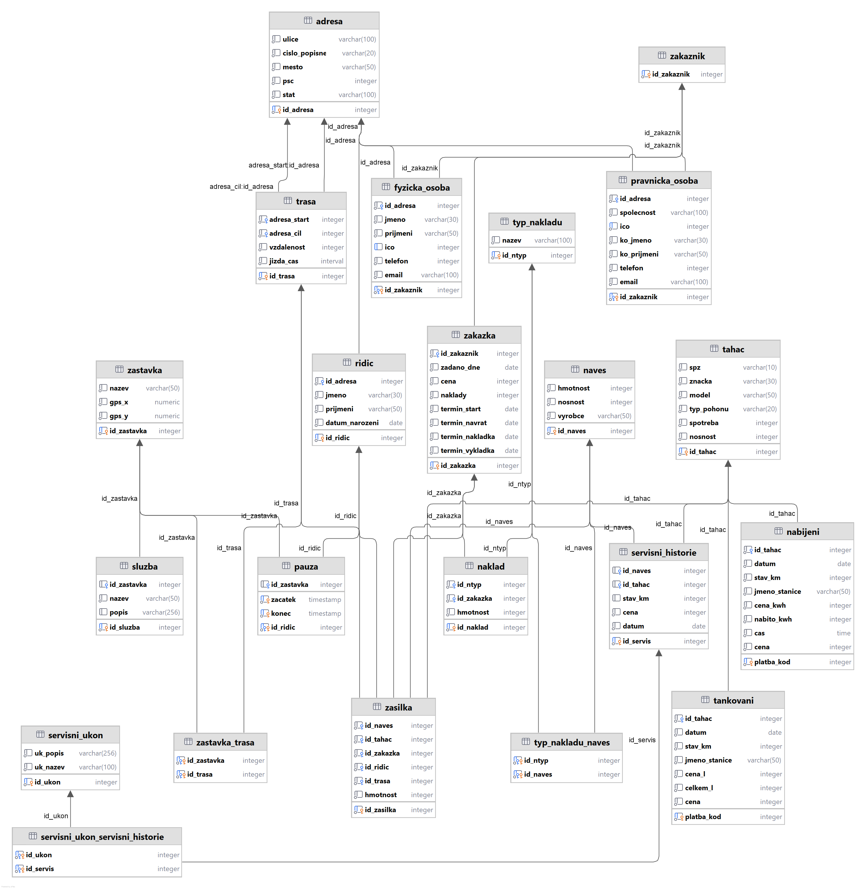

# Freight Logistics & Fleet Management Database System
> Enterprise relational database design, synthetic telemetry data pipeline, and advanced SQL analytical suite for an international freight shipping company (*Spedice Nedojel*).

[](https://www.postgresql.org/)
[](https://www.docker.com/)
[](LICENSE)
[](https://fit.cvut.cz/)

---

## Table of Contents
- [Project Overview](#project-overview)
- [Key Architectural & Design Highlights](#key-architectural--design-highlights)
- [Relational Data Model](#relational-data-model)
- [Advanced SQL & Relational Algebra Highlights](#advanced-sql--relational-algebra-highlights)
- [Quick Start (One-Click Docker Setup)](#quick-start-one-click-docker-setup)
- [Repository Structure](#repository-structure)
- [Query Breakdown & Categorization](#query-breakdown--categorization)
- [O projektu (česky)](#o-projektu-česky)
- [Author & Acknowledgments](#author--acknowledgments)

---

## Project Overview

**Spedice Nedojel** is a comprehensive relational database engineered to model the end-to-end operational workflows of a mid-to-large European freight shipping company.

The system manages:
- **Multi-Modal Commercial Fleet:** Heavy-duty tractor trucks (diesel internal combustion and electric powertrains) coupled with diverse semi-trailers (bulk liquid tankers, refrigerated units, hazardous ADR transports, general dry freight).
- **Driver Workflows & Legal Compliance:** Driver assignments, licensing records, and strictly monitored rest breaks at designated rest stops with roadside amenities (restrooms, showers, EV fast chargers) conforming to road safety regulations.
- **Client & Order Lifecycle:** B2B corporate entities and B2C individual clients, multi-leg transport orders subdivided into trackable shipments with distinct drivers, routes, and vehicle combinations.
- **Telemetry & Energy Tracking:** Granular per-session energy logs, comparing fuel volume and costs for diesel trucks against kilowatt-hours and charging durations for electric fleets.
- **Fleet Maintenance & Workshop Records:** Scheduled preventive checkups, unplanned repairs, and component servicing enforced with strict integrity constraints.

The database is built on **PostgreSQL 16**, fully normalized (3NF/BCNF), populated with ~2,200 synthetic records, and accompanied by 26 complex analytical queries formally proven in Relational Algebra.

---

## Key Architectural & Design Highlights

### 1. Exclusive OR (XOR) Polymorphic Integrity Constraint
Maintenance records in `servisni_historie` can apply either to a tractor truck (`tahac`) or to a semi-trailer (`naves`), but **never both** and **never neither**. This business rule is guaranteed at the database engine level via a table check constraint:
```sql
ALTER TABLE servisni_historie 
ADD CONSTRAINT xc_servisni_historie_id_naves_i 
CHECK (
    (id_naves IS NOT NULL AND id_tahac IS NULL) OR 
    (id_naves IS NULL AND id_tahac IS NOT NULL)
);
```

### 2. Customer Inheritance & Role Specialization
The customer model utilizes table inheritance patterns separating base identities (`zakaznik`) into:
- `pravnicka_osoba` (Legal entities / B2B): Company registration (IČO), corporate billing, designated contact representatives.
- `fyzicka_osoba` (Natural persons / B2C): Personal identification, direct contact details, and optional sole-proprietor IČO.

### 3. Dual-Power Telemetry Separation
Rather than a loose generic table, refueling and recharging are strictly separated into dedicated relation structures:
- `tankovani`: Fuel liters, price per liter, station name, odometer reading.
- `nabijeni`: Energy consumed (kWh), price per kWh, charging duration (`TIME`), and odometer reading.

### 4. Route Geometries & Driver Rest Regulation
Each route (`trasa`) defines origin and destination addresses, distance, and interval-based driving duration (`INTERVAL`). Intermediate mandatory rest stops (`zastavka_trasa`) log coordinates (`gps_x`, `gps_y`) and available roadside services (`sluzba`: WC, showers, charging hubs) to ensure driver welfare and regulatory compliance.

---

## Relational Data Model

The complete relational schema comprises **17 base tables** and **3 associative tables** connected by 22 cascading foreign key constraints.

<p align="center">
  
</p>

> [!TIP]
> A full-resolution vector/raster diagram (3000 × 3078 px) is available in [`docs/relational_schema.png`](docs/relational_schema.png).

---

## Advanced SQL & Relational Algebra Highlights

The repository features 26 production-grade analytical queries demonstrating mastery over foundational database theory, set operations, and SQL execution engines.

### Highlight 1: Universal Quantification / Relational Division ($R \div S$)
**Problem:** *Find all tractor trucks that have undergone EVERY defined maintenance procedure registered in the system.*

In Relational Algebra:
$$\{ \{\text{servisni\_ukon\_servisni\_historie} \bowtie \text{servisni\_historie}\}[\text{id\_tahac}, \text{id\_ukon}] \div \text{servisni\_ukon}[\text{id\_ukon}] \} \bowtie \text{tahac}$$

In PostgreSQL (Double `NOT EXISTS`):
```sql
SELECT * FROM tahac t
WHERE NOT EXISTS (
    SELECT * FROM servisni_ukon su
    WHERE NOT EXISTS (
        SELECT 1 
        FROM servisni_ukon_servisni_historie shu
        JOIN servisni_historie sh USING(id_servis)
        WHERE sh.id_tahac = t.id_tahac 
          AND su.id_ukon = shu.id_ukon
    )
);
```

---

### Highlight 2: Concept Equivalence (Same Problem in 3 SQL Paradigms)
**Problem:** *Display every driver along with their total count of dispatched shipments.*

Demonstrating three distinct query optimization approaches:
```sql
-- Approach 1: Correlated Scalar Subquery in SELECT
SELECT *, (SELECT COUNT(*) FROM zasilka z WHERE r.id_ridic = z.id_ridic) AS pocet_zasilek
FROM ridic r;

-- Approach 2: Set Theory with UNION & EXCEPT
SELECT r.*, COUNT(*) AS pocet_zasilek 
FROM ridic r JOIN zasilka USING (id_ridic) 
GROUP BY id_ridic
UNION
SELECT *, 0 AS pocet_zasilek 
FROM (
    SELECT r.* FROM ridic r 
    EXCEPT (SELECT DISTINCT ri.* FROM ridic ri JOIN zasilka USING (id_ridic))
);

-- Approach 3: Outer Join with Aggregate COALESCE (Idiomatic Production SQL)
SELECT r.*, COALESCE(p.pocet_zasilek, 0) AS pocet_zasilek
FROM ridic r
LEFT JOIN (
    SELECT id_ridic, COUNT(*) AS pocet_zasilek
    FROM zasilka
    GROUP BY id_ridic
) p ON r.id_ridic = p.id_ridic;
```

---

### Highlight 3: Set Operations (`INTERSECT` & `EXCEPT`)
**Problem:** *Find drivers who have safely transported both dangerous goods (ADR) and fragile electronics.*
```sql
SELECT r.* 
FROM ridic r 
JOIN zasilka USING (id_ridic) 
JOIN naklad USING(id_zakazka) 
JOIN typ_nakladu tn USING (id_ntyp) 
WHERE tn.nazev = 'Elektronika'

INTERSECT

SELECT r.* 
FROM ridic r 
JOIN zasilka USING (id_ridic) 
JOIN naklad USING(id_zakazka) 
JOIN typ_nakladu tn USING (id_ntyp) 
WHERE tn.nazev = 'Nebezpečný náklad (ADR)';
```

---

### Highlight 4: Multi-Condition Group Aggregation with Nested Benchmark
**Problem:** *Select corporate clients based in the Czech Republic who placed at least 3 shipments and whose average shipment weight exceeds the entire company-wide average.*
```sql
SELECT zak.id_zakaznik, COUNT(*) AS pocet_zasilek, AVG(z.hmotnost) AS prumerna_hmotnost
FROM zasilka z 
JOIN zakazka zak USING(id_zakazka) 
JOIN pravnicka_osoba po USING (id_zakaznik) 
JOIN adresa a USING (id_adresa) 
WHERE a.stat = 'Česká republika'
GROUP BY zak.id_zakaznik
HAVING COUNT(*) >= 3
   AND AVG(z.hmotnost) > (
       SELECT AVG(z2.hmotnost)
       FROM zasilka z2
   )
ORDER BY AVG(z.hmotnost) DESC;
```

---

### Highlight 5: ACID Transactional Data Manipulation
Safe modification scripts demonstrating rollback guarantees (`BEGIN` ... `ROLLBACK`) for batch inserts, conditional cost updates, and cleanup cascades.

*(See [`sql/03_queries.sql`](sql/03_queries.sql) for all 26 complete queries with relational algebra translations).*

---

## Quick Start (One-Click Docker Setup)

Get a fully working PostgreSQL instance running with the schema created and ~2,200 seed records preloaded in seconds.

### Prerequisites
- [Docker](https://docs.docker.com/get-docker/) & [Docker Compose](https://docs.docker.com/compose/)

### 1. Clone & Launch
```bash
git clone https://github.com/msiro/freight-logistics-database.git
cd freight-logistics-database
docker compose up -d
```

### 2. Connect to the Database
Open an interactive `psql` shell inside the running container:
```bash
docker exec -it spedice_nedojel_db psql -U postgres -d spedice_nedojel
```

Or connect with your favorite database GUI client:
- **Host:** `localhost`
- **Port:** `5432`
- **Database:** `spedice_nedojel`
- **Username:** `postgres`
- **Password:** `postgrespassword`

### 3. Run Query Suite
Execute any query directly inside `psql`:
```sql
-- Example: View top 3 clients by cargo volume
SELECT id_zakaznik, SUM(hmotnost) AS celkova_hmotnost
FROM zasilka JOIN zakazka USING(id_zakazka)
GROUP BY id_zakaznik
ORDER BY celkova_hmotnost DESC
LIMIT 3;
```

### 4. Teardown
```bash
docker compose down -v
```

---

## Repository Structure

```text
├── docker-compose.yml           # 1-command reproducible PostgreSQL 16 environment
├── .gitignore                   # Standard ignore rules (IDE, OS, virtual environments)
├── LICENSE                      # MIT Open Source License
├── README.md                    # Project documentation & presentation
│
├── sql/
│   ├── 01_schema.sql            # Clean DDL: tables, indexes, constraints, XOR logic
│   ├── 02_seed.sql              # Realistic seed dataset (~2,200 rows)
│   └── 03_queries.sql           # 26 queries: descriptions, relational algebra, and SQL
│
├── docs/
│   ├── relational_schema.png    # High-resolution (3000x3078) ER diagram
│   ├── report.html              # Standalone interactive HTML report (viewable in any browser)
│   ├── sproject_html.css        # Report presentation stylesheet
│   └── queries_breakdown.md     # Complete query-to-category cross-reference matrix
│
├── scripts/
│   └── generate_routes.py       # Python script for realistic route and duration synthesis
│
└── original_submission/         # Preserved academic submission archive (ČVUT FIT template)
    ├── main.xml                 # Original XML specification
    ├── sproject.dtd             # Course DTD validator
    └── sproject_html.xsl        # Course XSLT stylesheet
```

---

## Query Breakdown & Categorization

The queries fulfill all category requirements specified in university relational database coursework:

| Code | Query Category Description | Highlight Query |
| :---: | :--- | :---: |
| **A** | Positive join over at least two tables | [`D1`](docs/queries_breakdown.md#d1) |
| **B** | Negative join / difference | [`D14`](docs/queries_breakdown.md#d14) |
| **C** | Exclusive relationship ("only related to...") | [`D5`](docs/queries_breakdown.md#d5) |
| **D1** | Universal Quantification / Relational Division | [`D4`](docs/queries_breakdown.md#d4) |
| **D2** | Verification query for D1 | [`D13`](docs/queries_breakdown.md#d13) |
| **F1 - F5** | Join variants (`ON`, `USING`, `CROSS`, `LEFT/RIGHT`, `FULL OUTER`) | [`D16`](docs/queries_breakdown.md#d16), [`D17`](docs/queries_breakdown.md#d17) |
| **G1 - G4** | Nested subqueries (`WHERE`, `FROM`, `SELECT`, `EXISTS/NOT EXISTS`) | [`D4`](docs/queries_breakdown.md#d4), [`D8`](docs/queries_breakdown.md#d8), [`D17`](docs/queries_breakdown.md#d17) |
| **H1 - H3** | Set operations (`UNION`, `EXCEPT`, `INTERSECT`) | [`D19`](docs/queries_breakdown.md#d19), [`D20`](docs/queries_breakdown.md#d20) |
| **I1 - I2** | Aggregations & Grouping (`COUNT`, `AVG`, `SUM`, `GROUP BY`, `HAVING`) | [`D18`](docs/queries_breakdown.md#d18), [`D26`](docs/queries_breakdown.md#d26) |
| **J** | Identical query expressed in 3 distinct SQL formulations | [`D19`](docs/queries_breakdown.md#d19) |
| **K** | Full clause coverage (`SELECT-FROM-WHERE-GROUP BY-HAVING-ORDER BY`) | [`D18`](docs/queries_breakdown.md#d18) |
| **L - M** | Database Views & Queries over Views | [`D21`](docs/queries_breakdown.md#d21), [`D22`](docs/queries_breakdown.md#d22) |
| **N - P** | Transactional DML (`INSERT ... SELECT`, `UPDATE ... WHERE IN`, `DELETE`) | [`D23`](docs/queries_breakdown.md#d23), [`D24`](docs/queries_breakdown.md#d24), [`D25`](docs/queries_breakdown.md#d25) |

*(See [`docs/queries_breakdown.md`](docs/queries_breakdown.md) for the full matrix).*

---

## O projektu (česky)

Tento projekt vznikl jako semestrální práce v rámci předmětu **BI-DBS (Databázové systémy)** na **Fakultě informačních technologií ČVUT v Praze**. 

Cílem práce bylo navrhnout a implementovat kompletní relační databázi pro fiktivní spediční společnost **Spedice Nedojel**, která se zabývá mezinárodní kamionovou přepravou. 

### Hlavní přínosy a praktické prvky:
- **Komplexní relační model:** Detailní provázání tahačů (nafta i elektro), návěsů různých typů, řidičů, tras, povinných přestávek i servisní historie.
- **Integritní omezení:** Využití XOR vazby pro servisní záznamy (servis náleží buď tahači, nebo návěsu) a kaskádních cizích klíčů.
- **Relační algebra a pokročilé SQL:** Formální zápis dotazů v relační algebře a jejich implementace v PostgreSQL (včetně relační divize přes dvojitý zápor, množinových operací `INTERSECT`/`EXCEPT` a transakčních bloků).
- **Testovací data:** Skripty pro generování realistických tras a časů jízd, celkově přes 2 200 záznamů.
- **Snadné spuštění:** Kompletní Dockerizované prostředí pro okamžité vyzkoušení jedním příkazem.

---

## Author & Acknowledgments

- **Author:** [Matěj Široký](https://github.com/msiro)
- **Institution:** Czech Technical University in Prague (ČVUT), Faculty of Information Technology
- **Course:** BI-DBS (Database Systems)
- **Email:** msiroky9@gmail.com
